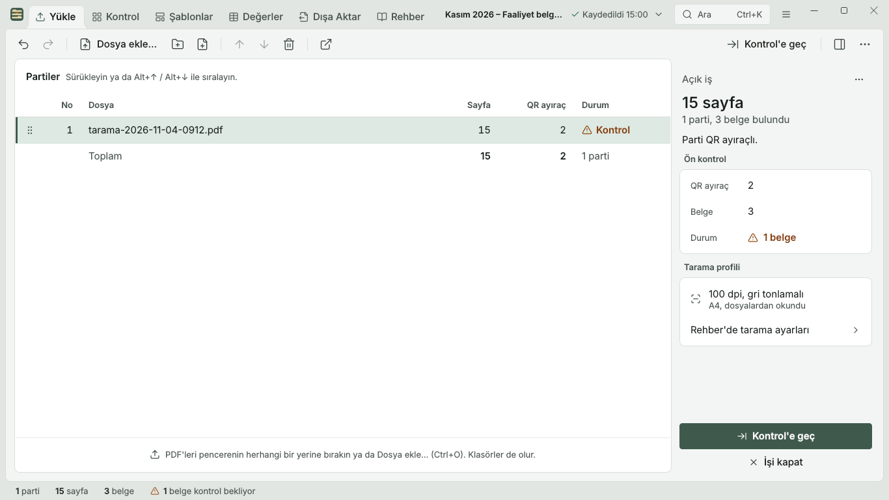
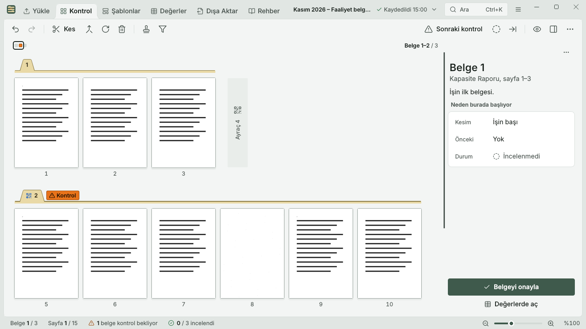
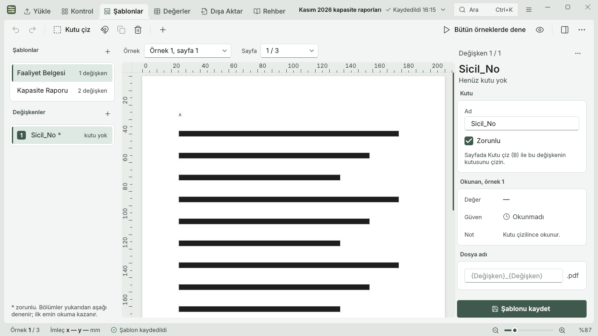
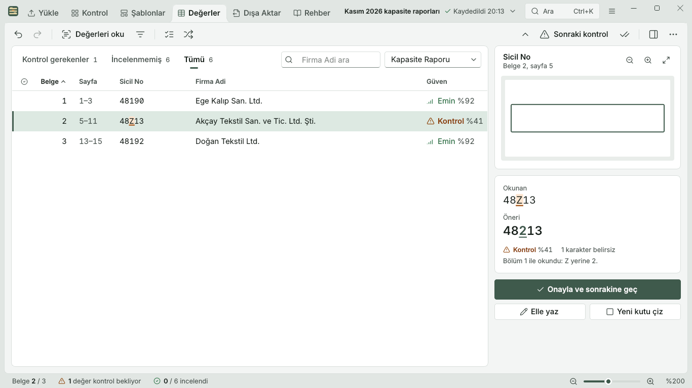
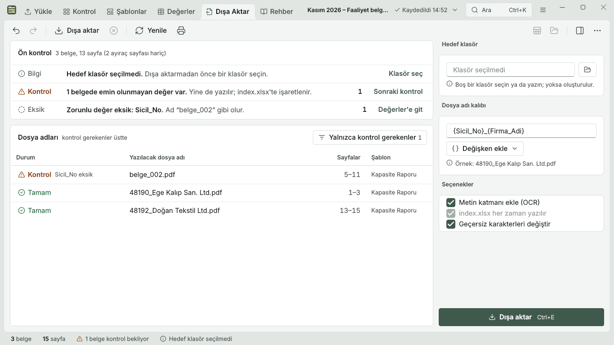
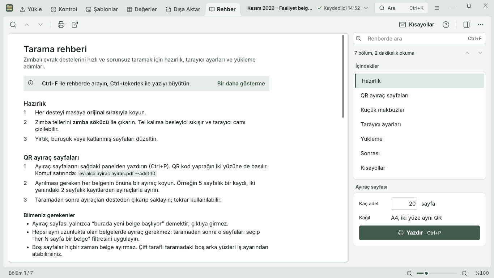

# Evrakçı

**English** | [Türkçe](README.tr.md)

[](https://github.com/ZackHaronOriginal/Evrakci/actions/workflows/ci.yml)

**An open-source, all-round quality-of-life toolbox for paperwork at chambers of commerce.**
The first module, *Tara ve Ayır* (scan and split), turns a big scanned pile into split,
searchable PDFs, one per document, named from values read off the page. Documents never
leave the building.

Built for any chamber of commerce or commodity exchange, and configurable for anyone else:
the app decides nothing about what your documents contain.

## Status

🚧 Early development. Not ready for production use yet.

## How it works

```
Pile of paper ──► unstaple once ──► feed through the copier in batches ──► scanned PDFs
                                                                              │
   1. Job          combine the batches, in order  ◄──────────────────────────┘
   2. Split        QR separator pages + filters on selected pages ("every N pages")
   3. Timeline     see every page, fix cuts, rotate or delete pages
   4. OCR          Turkish text layer, searchable PDFs
   5. Templates    your own variables, e.g. {Firma_Unvani}, drawn on example documents
   6. Review       check and fix the values read
   7. Export       one PDF per document, named from your variables, plus an Excel index
```

Every step works from the command line (see below) and in the window (`evrakci-arayuz`).
Design: [docs/superpowers/specs/2026-11-06-scan-and-split-design.md](docs/superpowers/specs/2026-11-06-scan-and-split-design.md)

## The window

Six tabs, the same core as the command line. Screens shown with invented example data only.

| | |
|---|---|
|  |  |
|  |  |
|  |  |

## Principles

- **Local-first.** A desktop app (Windows first, Linux and macOS too) running on the chamber's own computers. No cloud OCR, no uploads to third parties.
- **Human in the loop.** The software suggests and staff confirm. OCR will make mistakes, and the review screen is where they get caught.
- **Turkish-first.** The UI, command line and guide are in Turkish.
- **Configurable, not hardcoded.** Users create their own templates and variables. Nothing about
  any specific document is built into the code.
- **CLI first.** Everything works from the `evrakci` command line. The window is a second entry
  point over the same core.
- **Easy install.** A normal Windows installer for staff. No Python knowledge needed.

## Repository layout

```
src/evrakci/pipeline/   Core processing (no Qt): jobs, page analysis, cuts, writing PDFs
src/evrakci/cli/        The `evrakci` command line
src/evrakci/ui/         PySide6 (Qt) window (`evrakci-arayuz`)
tests/                  Automated tests
docs/                   Architecture, licensing, Turkish scanning guide
samples/synthetic/      SYNTHETIC test documents only (see below)
```

## ⚠️ Never commit real documents

This repository is public. **Do not commit real documents or anything containing
member data**, not even "just for testing". Use synthetic documents in `samples/synthetic/`.
Real scans belong in `data/`, which is git-ignored.

## Install (Windows)

The installer is built automatically by GitHub Actions ("Windows installer" workflow):
open the latest successful run and download the **Evrakci-Kurulum** artifact. It installs
the window (`evrakci-arayuz`), the command line (`evrakci`), Tesseract and the official
Turkish OCR data — nothing else to install. Job data stays in your user folder and is kept
when you uninstall. Licences of bundled components: `licenses\NOTICE.txt` in the install folder.

## Install (Linux)

The "Linux build" workflow builds `evrakci-<sürüm>-linux-x86_64.tar.gz` and its `.sha256`
(artifact **Evrakci-Linux**). It is built on Ubuntu 22.04 and tested on clean Debian 12 and
Ubuntu 24.04 systems, so it runs on Ubuntu 22.04 or newer, Debian 12 and Pardus 23. Tesseract
comes from the system; the Turkish OCR data (tur_best) is bundled. Most desktops already have
the window libraries; on a minimal system install them with:

```bash
sudo apt install tesseract-ocr libxcb-cursor0 libxcb-icccm4 libxcb-util1 libxcb-image0 \
  libxcb-keysyms1 libxcb-render-util0 libxcb-xkb1 libxcb-shape0 libxkbcommon-x11-0 libegl1 libgl1 libdbus-1-3
```

```bash
tar -xzf evrakci-0.0.1-linux-x86_64.tar.gz
```

```bash
./evrakci-0.0.1/kur.sh
```

`kur.sh` installs for the current user only (never with sudo), adds Evrakçı to the applications
menu and links `evrakci` and `evrakci-arayuz` into `~/.local/bin` (on Ubuntu, log out and in
once if that folder was new). It warns about any missing system library and prints the exact
uninstall command (normally `~/.local/share/evrakci-uygulama/kaldir.sh`); uninstalling keeps
jobs and templates. Close Evrakçı before installing a new version.

## Development

```bash
python -m venv .venv
source .venv/bin/activate        # Windows: .venv\Scripts\activate
pip install -e ".[dev]"
ruff check . && pytest
```

`evrakci` runs the command line. `evrakci-arayuz` opens the window.

### Command line (komut satırı)

```bash
evrakci ayirac ayirac.pdf --adet 10                 # print QR separator sheets
evrakci is olustur "Seçim 2026" tarama1.pdf tarama2.pdf   # prints the job id
evrakci is filtre <id> 1-40 2                       # pages 1-40: every 2 pages is a document
evrakci is kes <id> 57                              # extra cut before page 57
evrakci is goster <id>                              # list the documents
evrakci is disa-aktar <id> --cikti cikti            # one PDF per document
```

Every exported PDF gets a searchable Turkish text layer and is saved as PDF/A-2b (no Ghostscript).
If a file fails the PDF/A check it is saved as a normal searchable PDF and the output says so.
`--metin-katmani-yok` skips the text layer. A single file: `evrakci ocr giris.pdf cikti.pdf`.
OCR uses Tesseract with the official `tur_best` data when installed (`evrakci ocr-modelleri-indir`).
See [docs/ocr-motor-karsilastirma.md](docs/ocr-motor-karsilastirma.md) for the engine comparison.

Page numbers always match the order of the scanned pile. `evrakci --help` and
`evrakci is --help` list every command.

### Templates (şablonlar)

A template is made by you: name your own variables, then mark where each one is on the page
(millimetres from the top-left). Add more boxes (variants) from other example documents of the
same kind; they are tried in order and the first confident reading wins.

```bash
evrakci sablon olustur "Seçim Yetki Belgesi"                      # prints the template id
evrakci sablon degisken-ekle <sablon> "Firma Ünvanı" --zorunlu
evrakci sablon bolum-ekle <sablon> "Firma Ünvanı" --sayfa 1 --kutu 20,40,150,50
evrakci sablon bolum-ekle <sablon> "Firma Ünvanı" --sayfa 1 --kutu 20,40,150,62 --ornek uzun.pdf
evrakci sablon dosya-adi <sablon> "{Firma Ünvanı}"
evrakci sablon test <sablon> ornek.pdf                            # see what each box reads
evrakci is sablon-uygula <id> 1-40 <sablon>
evrakci is oku <id>                                               # read every templated document
```

Templates can be shared between PCs with `sablon disa-aktar` / `sablon ice-aktar`.

### Review and export

```bash
evrakci is degerler <id> --kontrol              # only documents that need a look
evrakci is deger <id> 3 "Firma Ünvanı" "Örnek Ticaret Ltd. Şti."   # fix a value
evrakci is deger <id> 5 "Kayıt No" --oneri      # accept what OCR suggested
evrakci is disa-aktar <id> --cikti cikti        # named PDFs + index.xlsx
```

- Files are named from the template's pattern. Characters Windows forbids are removed, Turkish
  letters are kept, and clashing names get ` (2)`, ` (3)`.
- A missing or unsure **required** value is never put in a file name: that document is written
  as `belge_NNN.pdf` and marked.
- `index.xlsx` lists every file with its pages, template, values, PDF/A status and the reasons it
  needs a check.
- Export needs an empty folder, so files from an earlier export never mix in.
- Retention: `evrakci ayar saklama sakla` (default, never delete), `disa-aktarinca-sil` (delete
  the job after a full export), or a number of days (e.g. `30`).

System dependencies for OCR (later steps): Tesseract with the Turkish language pack (`tur`).

## Contributing

Contributions are welcome. Please read [CONTRIBUTING.md](CONTRIBUTING.md). All contributors
sign a short [Contributor License Agreement](CLA.md) on their first pull request.

## License

[AGPL-3.0-or-later](LICENSE). Free for any chamber to use and modify. Anyone who distributes the
app, or runs a modified version as a service for others, must share their source code. Commercial
licenses, support and hosting are available from the maintainer. See [docs/licensing.md](docs/licensing.md).
