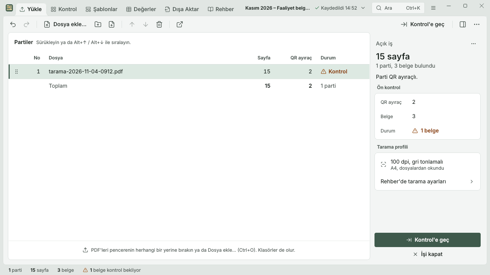
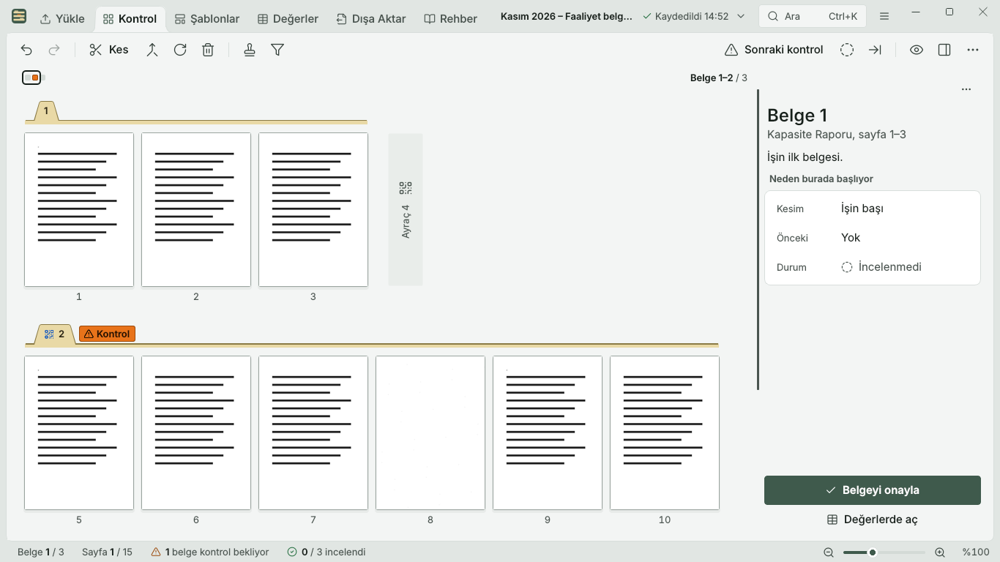
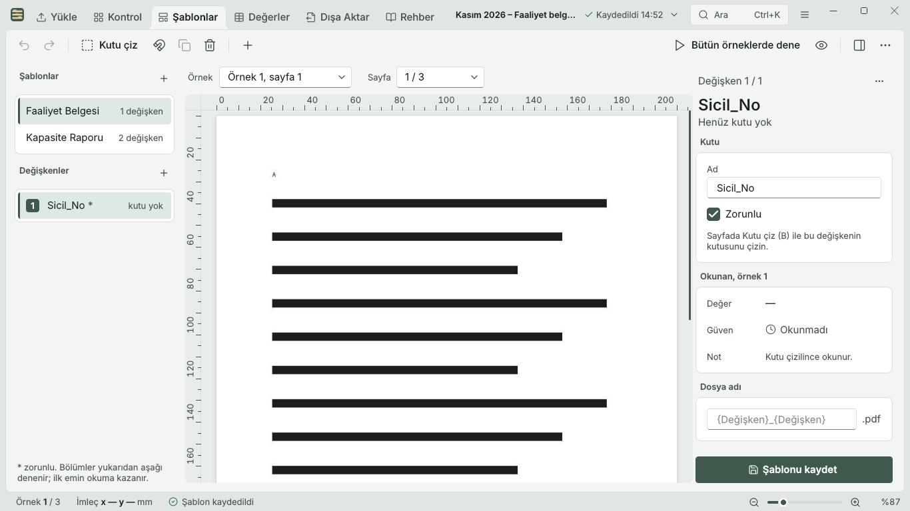
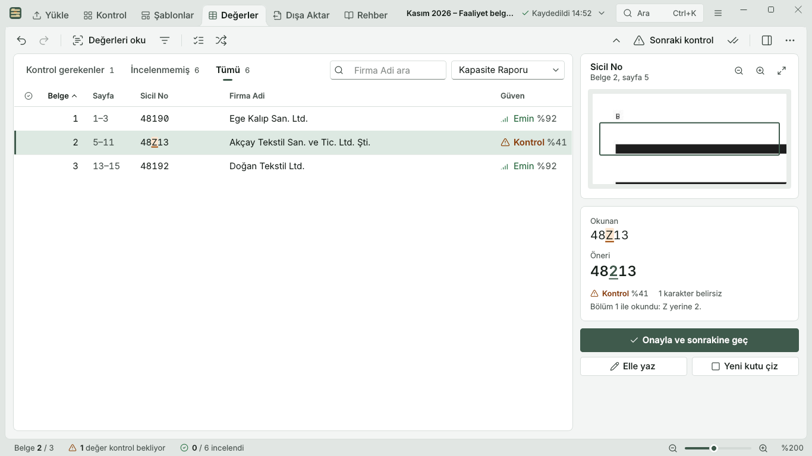
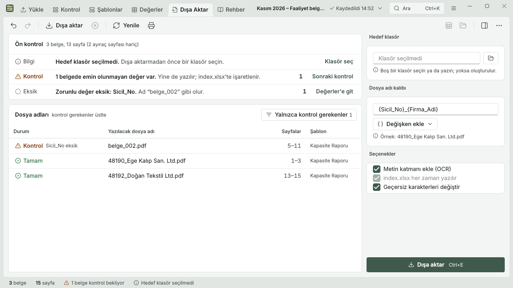
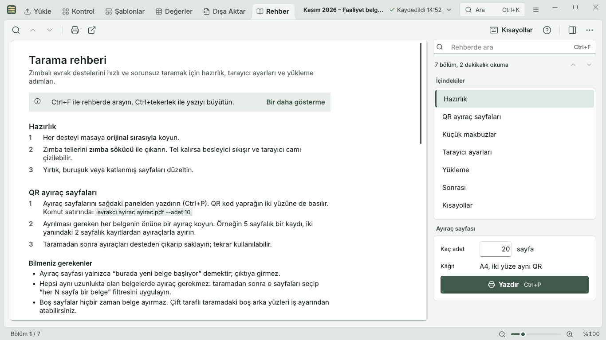

# Evrakçı

[English](README.md) | **Türkçe**

[](https://github.com/ZackHaronOriginal/Evrakci/actions/workflows/ci.yml)

**Ticaret ve sanayi odalarında evrak işleri için açık kaynaklı, çok yönlü bir kolaylık aracı.**
İlk modül *Tara ve Ayır*, taranmış büyük bir desteyi her belge için ayrı, aranabilir ve sayfadaki
bilgilere göre adlandırılmış PDF'lere dönüştürür. Belgeler binadan hiç çıkmaz.

Her oda ve borsa için tasarlanmıştır, herkes kendine göre ayarlayabilir: uygulama belgelerinizin
içeriği hakkında hiçbir şeyi önceden varsaymaz.

## Durum

🚧 Geliştirme aşamasında. Henüz günlük kullanıma hazır değil.

## Nasıl çalışır?

```
Evrak destesi ──► zımbaları bir kez sök ──► fotokopi besleyicisinden partiler halinde tara ──► PDF'ler
                                                                                               │
   1. İş           partileri sırasıyla birleştir  ◄───────────────────────────────────────────┘
   2. Ayır         QR ayıraç sayfaları + seçili sayfalara filtre ("her N sayfa bir belge")
   3. Zaman çizgisi tüm sayfaları gör, kesimleri düzelt, sayfa döndür veya sil
   4. OCR          Türkçe metin katmanı, aranabilir PDF'ler
   5. Şablonlar    kendi değişkenleriniz, örn. {Firma_Unvani}, örnek belge üzerinde işaretlenir
   6. Kontrol      okunan değerleri kontrol et ve düzelt
   7. Dışa aktar   her belge için ayrı PDF, değişkenlerinize göre adlandırılmış + Excel listesi
```

1–3. adımlar bugün komut satırından çalışıyor (aşağıya bakın). Diğerleri yapım aşamasında.
Tasarım belgesi: [docs/superpowers/specs/2026-11-06-scan-and-split-design.md](docs/superpowers/specs/2026-11-06-scan-and-split-design.md)

## Pencere

Başlık şeridinde altı sekme (Ctrl+1 – Ctrl+6), komut satırıyla aynı çekirdek. Ctrl+K komut
paletini, Shift+F1 tüm kısayolları, Ctrl+, ayarları açar (açık, koyu ve yüksek karşıtlık
temaları, %100 – %150 yazı boyutu, yoğunluk). Ekranlarda yalnızca uydurma örnek veriler vardır
(açık tema, 1366x768).

| | |
|---|---|
|  |  |
|  |  |
|  |  |

## İlkeler

- **Yerel çalışır.** Odanın kendi bilgisayarlarında çalışan bir masaüstü uygulamasıdır (önce Windows, ardından Linux ve macOS). Bulut OCR yok, üçüncü taraflara yükleme yok. KVKK açısından güvenlidir.
- **Son söz insanda.** Uygulama önerir, personel onaylar. OCR hata yapabilir; Kontrol ekranı bu hataları yakalamak içindir.
- **Önce Türkçe.** Arayüz, komut satırı ve rehber Türkçedir.
- **Ayarlanabilir, sabit kodlanmamış.** Şablonları ve değişkenleri kullanıcı oluşturur. Kodda
  belirli bir belgeye özgü hiçbir şey yoktur.
- **Önce komut satırı.** Her şey `evrakci` komut satırından yapılabilir. Pencere, aynı çekirdeğin
  üzerindeki ikinci bir giriş noktasıdır.
- **Kolay kurulum.** Personel için normal bir Windows kurulum dosyası. Python bilgisi gerekmez.

## Klasör yapısı

```
src/evrakci/pipeline/   Çekirdek işleme (Qt'siz): işler, sayfa inceleme, kesimler, PDF yazma
src/evrakci/cli/        `evrakci` komut satırı
src/evrakci/ui/         PySide6 (Qt) penceresi (`evrakci-arayuz`)
tests/                  Otomatik testler
docs/                   Mimari, lisans ve tarama rehberi
samples/synthetic/      Yalnızca SAHTE test belgeleri (aşağıya bakın)
```

Tarama rehberi: [docs/tarama-rehberi.md](docs/tarama-rehberi.md)

## ⚠️ Gerçek belgeleri asla yüklemeyin

Bu depo herkese açıktır. **Gerçek belgeleri veya üye bilgisi içeren hiçbir şeyi depoya
eklemeyin.** "Sadece test için" bile olsa. `samples/synthetic/` içindeki sahte belgeleri kullanın.
Gerçek taramalar git tarafından yok sayılan `data/` klasöründe durmalıdır.

## Kurulum (Windows)

Kurulum dosyası GitHub Actions'ta otomatik üretilir ("Windows installer" iş akışı): son başarılı
çalıştırmayı açıp **Evrakci-Kurulum** dosyasını indirin. Pencereyi (`evrakci-arayuz`), komut satırını
(`evrakci`), Tesseract'ı ve resmi Türkçe OCR verisini kurar; başka bir şey kurmanız gerekmez. İş
verileri kullanıcı klasörünüzde durur ve kaldırırken silinmez. Paketlenen bileşenlerin lisansları:
kurulum klasöründe `licenses\NOTICE.txt`.

## Geliştirme

```bash
python -m venv .venv
source .venv/bin/activate        # Windows: .venv\Scripts\activate
pip install -e ".[dev]"
ruff check . && pytest
```

`evrakci` komut satırını çalıştırır. `evrakci-arayuz` pencereyi açar.

### Komut satırı

```bash
evrakci ayirac ayirac.pdf --adet 10                 # QR ayıraç sayfaları yazdır
evrakci is olustur "Seçim 2026" tarama1.pdf tarama2.pdf   # iş numarasını yazar
evrakci is filtre <no> 1-40 2                       # 1-40. sayfalar: her 2 sayfa bir belge
evrakci is kes <no> 57                              # 57. sayfanın önüne ek kesim
evrakci is goster <no>                              # belgeleri listele
evrakci is disa-aktar <no> --cikti cikti            # her belge için ayrı PDF
```

Dışa aktarılan her PDF'e aranabilir Türkçe metin katmanı eklenir ve PDF/A-2b olarak kaydedilir
(Ghostscript gerekmez). PDF/A doğrulamasından geçemeyen dosya normal aranabilir PDF olarak yazılır
ve bu çıktıda belirtilir. `--metin-katmani-yok` metin katmanını atlar. Tek dosya için:
`evrakci ocr giris.pdf cikti.pdf`. OCR, kuruluysa Tesseract'ın resmi `tur_best` verisini kullanır
(`evrakci ocr-modelleri-indir`). Motor karşılaştırması:
[docs/ocr-motor-karsilastirma.md](docs/ocr-motor-karsilastirma.md).

Sayfa numaraları her zaman taranan destenin sırasıyla aynıdır. Tüm komutlar için:
`evrakci --help` ve `evrakci is --help`.

### Şablonlar

Şablonu siz yaparsınız: değişkenlere kendiniz ad verin, sonra her birinin sayfadaki yerini
işaretleyin (sol üst köşeden milimetre). Aynı türden başka örnek belgelerden ek kutular (varyant)
ekleyebilirsiniz; sırayla denenir, ilk güvenilir okuma kullanılır.

```bash
evrakci sablon olustur "Seçim Yetki Belgesi"                      # şablon numarasını yazar
evrakci sablon degisken-ekle <sablon> "Firma Ünvanı" --zorunlu
evrakci sablon bolum-ekle <sablon> "Firma Ünvanı" --sayfa 1 --kutu 20,40,150,50
evrakci sablon bolum-ekle <sablon> "Firma Ünvanı" --sayfa 1 --kutu 20,40,150,62 --ornek uzun.pdf
evrakci sablon dosya-adi <sablon> "{Firma Ünvanı}"
evrakci sablon test <sablon> ornek.pdf                            # her kutunun ne okuduğunu gör
evrakci is sablon-uygula <no> 1-40 <sablon>
evrakci is oku <no>                                               # şablonlu tüm belgeleri oku
```

Şablonlar `sablon disa-aktar` / `sablon ice-aktar` ile başka bilgisayarlara taşınabilir.

### Kontrol ve dışa aktarma

```bash
evrakci is degerler <no> --kontrol              # yalnızca kontrol gereken belgeler
evrakci is deger <no> 3 "Firma Ünvanı" "Örnek Ticaret Ltd. Şti."   # değeri düzelt
evrakci is deger <no> 5 "Kayıt No" --oneri      # OCR'ın önerisini kabul et
evrakci is disa-aktar <no> --cikti cikti        # adlandırılmış PDF'ler + index.xlsx
```

- Dosya adları şablonun kalıbından oluşur. Windows'un kabul etmediği karakterler çıkarılır, Türkçe
  harfler korunur, çakışan adlara ` (2)`, ` (3)` eklenir.
- Eksik veya emin olunamayan **zorunlu** değer dosya adına asla girmez: o belge `belge_NNN.pdf`
  olarak yazılır ve işaretlenir.
- `index.xlsx` her dosyayı sayfaları, şablonu, değerleri, PDF/A durumu ve kontrol nedenleriyle listeler.
- Dışa aktarma boş bir klasör ister; önceki dışa aktarımın dosyaları karışmaz.
- Saklama: `evrakci ayar saklama sakla` (varsayılan, hiçbir şey silinmez), `disa-aktarinca-sil`
  (tam dışa aktarımdan sonra iş silinir) veya gün sayısı (örn. `30`).

OCR için gerekli sistem programı (sonraki adımlar): Türkçe dil paketiyle (`tur`) Tesseract.

## Katkıda bulunma

Katkılarınızı bekliyoruz. Lütfen önce [CONTRIBUTING.md](CONTRIBUTING.md) dosyasını okuyun.
Tüm katkıda bulunanlar ilk pull request'lerinde kısa bir
[Katkıda Bulunan Lisans Sözleşmesi (CLA)](CLA.md) imzalar.

## Lisans

[AGPL-3.0-or-later](LICENSE). Her oda uygulamayı ücretsiz kullanabilir ve değiştirebilir. Uygulamayı
dağıtan veya değiştirilmiş bir sürümünü başkalarına hizmet olarak sunan herkes kaynak kodunu
paylaşmak zorundadır. Ticari lisans, destek ve barındırma hizmeti için proje sahibiyle iletişime
geçebilirsiniz. Ayrıntılar: [docs/licensing.md](docs/licensing.md)
