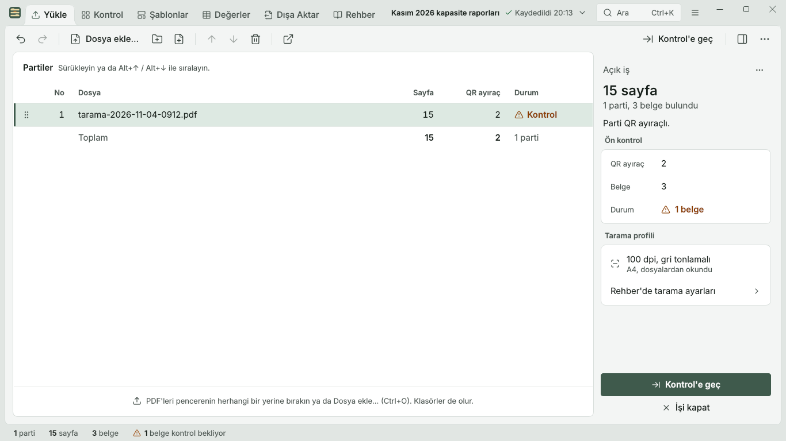
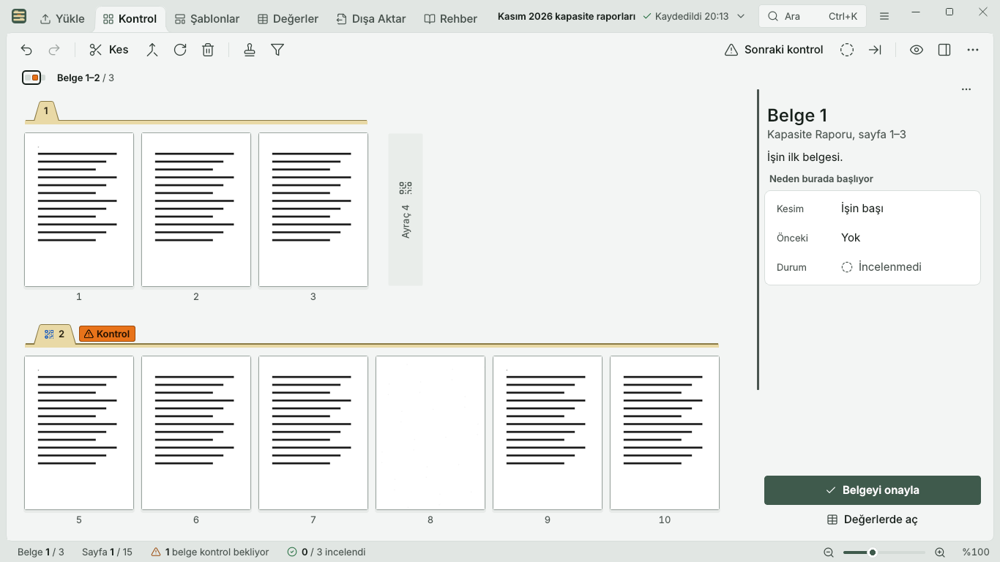
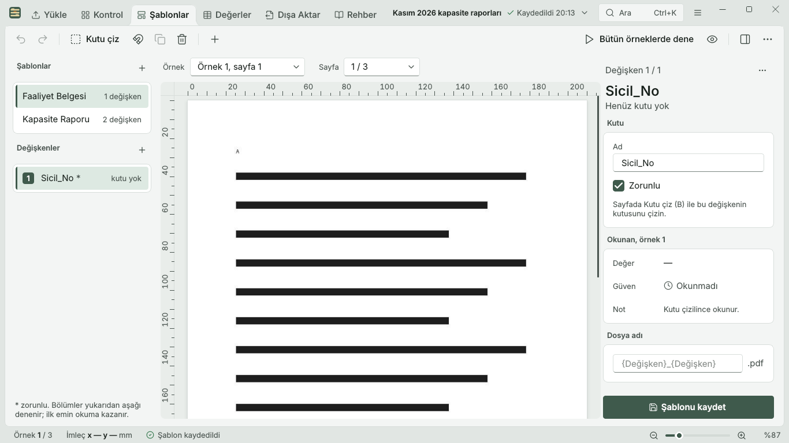
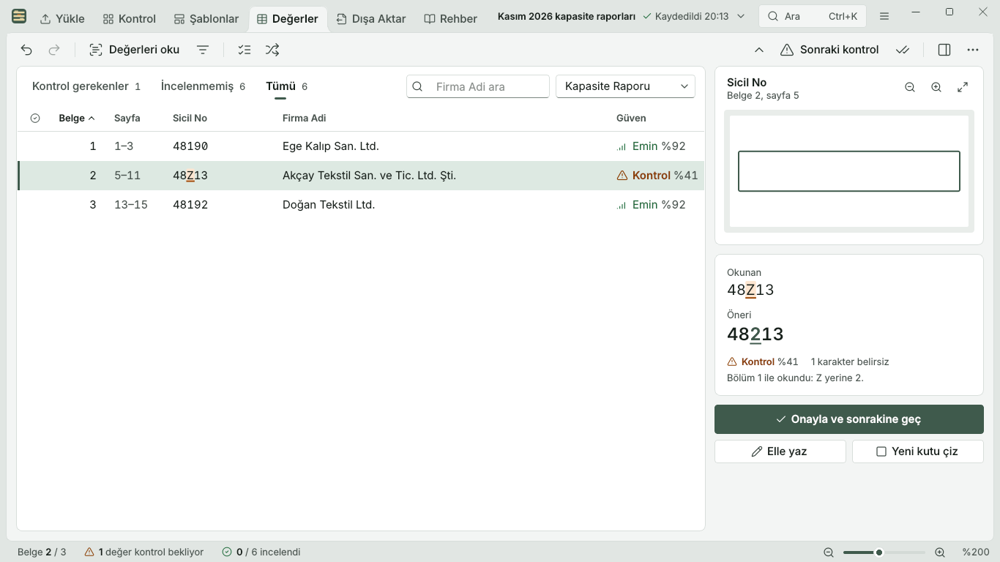
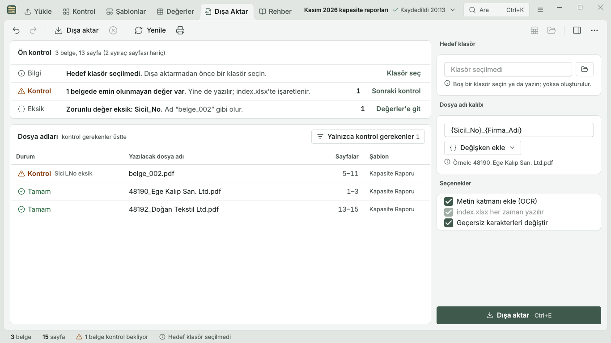
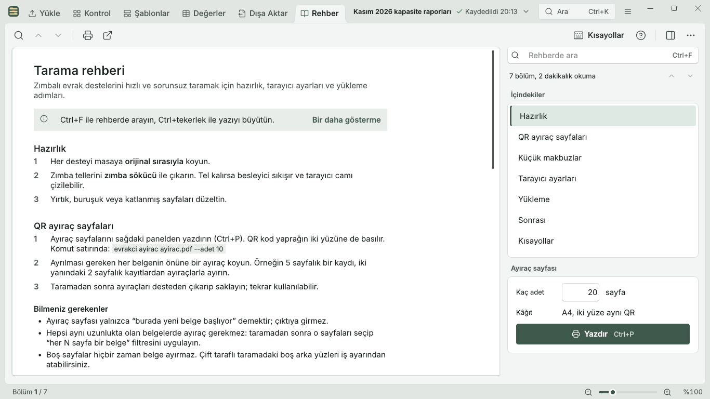

# Evrakçı UI overhaul: before and after

For the owner. Written 2026-11-13. The window now follows the approved direction A (Fluent 2 Mica)
mockups. Pictures are 1366x768, light theme, invented demo data. Before = commit `6fd57a0`.

## What changed, in short

- The six tabs now sit in the title band with the logo, job name, search and menu button, as in A.
  The old tab bar and toolbar rows are gone, so the pages have more room.
- Every tab has A's command bar, a right-hand inspector with one clear main button, and a status bar.
- Three themes (light, dark, high contrast) and text sizes 100 to 150 %.
- Ctrl+K command palette, Shift+F1 shortcut sheet, Ctrl+, settings, Ctrl+F find on every tab,
  one undo history that names each step, right-click menus, toasts with Undo, window state remembered.
- Empty states and error texts written for each tab.
- At 150 % text the tabs that do not fit go into a "»" menu (your option b).

## Side by side

### Yükle

Job and batch list, drop zone, read progress, inspector with the scan profile and one primary button.

| Before | After |
|---|---|
|  |  |

### Kontrol

Page strip with a guide tab per document, inspector card with approve button, loupe on Space.

| Before | After |
|---|---|
|  |  |

### Şablonlar

Variable list on the left, page canvas with numbered boxes and zoom, Okunan card.

| Before | After |
|---|---|
|  |  |

### Değerler

Review table with confidence column, crop of the scan, Enter accepts, F2 edits.

| Before | After |
|---|---|
|  |  |

### Dışa Aktar

Pre-flight list of files and blockers, file-name pattern, folder, progress and done card.

| Before | After |
|---|---|
|  |  |

### Rehber

Scanning guide with search and the separator sheets to print.

| Before | After |
|---|---|
|  |  |

## Verification numbers

- **Tests:** 1091 passed, 6 skipped, 1 warning (`pytest -q`, offscreen; two sequential runs, same result). `ruff check .`: All checks passed! (Before the overhaul: 525.) One earlier full run under load showed 60 failed / 41 errors in UI tests that pass on their own and on a clean re-run; treated as a load flake, not reproduced.
- **Contrast:** the theme tests require at least 4.5:1 for every text and background pair in
  light, dark and high contrast; the marked-character wash is held at 7:1. The mockup check
  `_contrast.py` found 0 failing pairs.
- **Clipping:** `tools/screenshots.py matrix docs/ui-goal/shots/final` shot 72 images (6 tabs x 3 themes x 2 window sizes x 100/150 % text). Summary line, verbatim: `ÖZET: 72 görüntü, 0 kırpılma/taşma`. Four shots checked by eye (Kontrol light 1366x768 100 %, Değerler dark 1366x768 150 %, Dışa Aktar high contrast 1920x1080 150 %, Yükle light 1366x768 150 %): no clipped or overlapping text; at 150 % the tabs collapse into the "»" menu, Değerler company names wrap, and the side panels scroll inside (their last card meets the scroll edge by design).
- **Fidelity to A:** the mockup check `_fidelity.py` passes (52 checks, max channel delta 0/255 for
  Kontrol and Değerler light and dark). The real app against A's PNGs (light, 100 %, coarse pixel
  difference, a drift signal only because the demo data differs): Yükle 2.8 %, Kontrol 6.7 %,
  Şablonlar 7.4 %, Değerler 6.5 %, Dışa Aktar 4.7 %, Rehber 5.2 %.

## Top 25 quality-of-life items

24 shipped, 1 deferred, 0 partly. Full table with where each lives: `docs/ui-goal/top25.md`.

## Deferred, and why

- **First-run tour (item 25):** A has no drawing for it and new looks need your approval. Rehber's
  tip covers first use.
- **Completion sound (item 25):** the app has no sound code or asset, the taskbar flash already
  signals the end, and a sound needs your yes.
- **Invert selection (item 12):** its usual key Ctrl+I uses the letter I, which is banned for the
  Turkish I/İ problem, and A has no place for it.
- **Screen reader test (item 21):** needs a Windows machine with NVDA or Narrator.
- **Later update, already approved by you:** Şablonlar "show only the selected variable's boxes" (H)
  and "delete the selected box" (Del, undoable).

## Decisions waiting for you

1. **Tabs at 150 % text:** you chose option b. It is built (labels kept, rest in a "»" menu), so
   nothing is left to decide unless you want to see it on a real screen first.
2. **PROPOSALS.md** (`docs/ui-goal/mockups/final-a/PROPOSALS.md`), nothing here is applied:
   - Items 1 and 5: a hairline above the pinned button and cut rows in scrolling side panels at 150 %.
   - Item 2: pin the Güven column at 150 % in Değerler.
   - Item 4: "Kontrol'e geç" appears twice on Yükle, as "Değerlerde aç" does in A.
   - Phase 3 notes D1-D2, K1-K5, Y1-Y6, S1-S9, E1-E9: states and wording A does not draw.
   - Phase 4: P4-1 save wording, P4-2 file-name card, P4-3 dashed variant boxes, P4-6 Güven fit
     rule, P4-8 single-key shortcuts row, P4-9 undo history submenu, P4-10 Kutu key hint,
     P4-11 Yükle empty-page title, P4-12 uncertain characters on the scan, P4-13 file-list filter.
